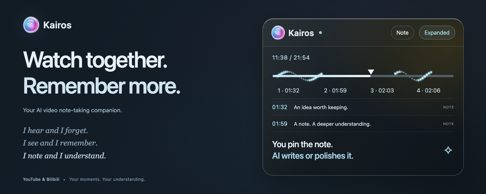

<p align="center">
  
</p>

<p align="center">
  
</p>

<h1 align="center">Kairos</h1>

<p align="center">
  <em><strong>Kairos = Vital Moments.</strong></em><br/>
  <strong>Watch together. Remember more.</strong><br/>
  <sub>Transform linear videos into queryable knowledge bases.</sub>
</p>

<p align="center">
  <a href="README.zh-CN.md">中文文档</a> ·
  <a href="#-quick-start">Quick Start</a> ·
  <a href="#-key-features">Features</a>
</p>

---

How can watching knowledge-dense videos become more valuable and interactive?

Kairos is a video note-taking agent built on multimodal AI providers, currently shipped as a Chrome Extension. While you watch high-information-density videos on Coursera / Udemy / Bilibili / YouTube / TED, Kairos lets you take notes elegantly without breaking your flow. With simple, intuitive interactions combined with intelligent visual understanding and semantic analysis, every vital moment (Kairos) is captured precisely — turning your fragmented video notes into a queryable, indexable knowledge base.

Kairos is a **Proactive + Reactive** agent:

- **Proactive**: Kairos watches the video with you and automatically discovers highlights and key points.
- **Reactive**: You provide the signal; the AI reduces the noise and fills in the fidelity.

### AI providers and models

Settings supports Gemini, OpenAI, Anthropic Claude, DeepSeek, Kimi and OpenRouter, with independent keys and model preferences. Provider cards include brand marks, plain-language setup guidance, Chinese/English localization and system light/dark themes.

Curated on 2026-11-02 for screenshot understanding and note summaries: Gemini 3.1 Flash-Lite / 3.8 Flash; GPT-6.1 Terra / GPT-6 Astra / GPT-6.1 Sol / GPT-6 Luna (OpenAI refreshed 2026-11-04); Claude Haiku / Sonnet 5.5; DeepSeek Flash; Kimi K3.1 Pro / K3; and GPT-5.4 mini / Claude Sonnet 5.5 through OpenRouter. Retired Kimi 2.5 and removed Highspeed settings migrate to K3.1 Pro. OpenAI mini/nano settings migrate to Terra/Luna respectively; existing keys are retained. Experimental video-URL HUD analysis remains Gemini-only.

API billing, regional access and model availability depend on your provider account. Keys use the existing Chrome sync storage. Requests go directly to the chosen provider; OpenRouter forwards requests to its routed upstream provider. Summaries send stored text and subtitle context, not screenshots. Tests cover mocked API contracts and real Chrome settings interactions, not paid end-to-end calls to all providers.


Model references: [Gemini](https://ai.google.dev/gemini-api/docs/models), [OpenAI](https://developers.openai.com/api/docs/guides/latest-model), [Claude](https://platform.claude.com/docs/en/models/overview), [DeepSeek](https://api-docs.deepseek.com/guides/vision/), [Kimi](https://platform.kimi.ai/docs/models), [OpenRouter](https://openrouter.ai/api/v1/models).

## Current companion experience

- **Summarize & share** in the note dashboard turns a video’s saved text notes and transcript context into an editable AI summary with timestamps. Copy it with its source link or download Markdown. Summaries stay in local extension storage; screenshot images are not sent for this operation. Preview and download a locally rendered PNG share image with the video title, takeaways, source and Kairos branding. Images are 1080px wide and grow with the edited text.
- Enable Kairos in the video’s glass island, then type to take a note or left-drag to capture a rectangular region. Player controls remain accessible. Empty captures are discarded; successfully saving a note resumes playback.
- Hover over the island to expand it, or use **Expand** to keep it open. Drag to reposition it and resize from its edges; position and size preferences carry across videos. Notes are available in the island and in the windowed sidebar.
- The timeline uses a triangular playhead and small glowing note markers. Dense markers form a subtle wave; clicking still seeks to the note’s exact timestamp.
- Saved notes automatically appear near their playback time, including text-only and older notes without capture coordinates. **Hover over a preview to keep reading while the video continues; move away to let it fade out.** Returning during the fade keeps it visible. Disabling Kairos clears previews.
- Delete notes with the trash button and inline confirmation, without leaving fullscreen. The island reports save results separately from viewing notes.
- Interface language follows the system or can be set to Chinese/English, independently of the AI note language. Export notes as Markdown from the sidebar or popup.

The sections below also describe longer-term product directions; they are not a release checklist.

## 🎯 Core Philosophy

Traditional video learning is linear and unstructured — you have to scrub the progress bar to find information. Taking notes while watching is painful — you must manually screenshot into another app and type everything yourself.

Kairos redefines how you take notes on videos:

- **Flow mode**: following Granola's design philosophy — "imperceptible AI" that augments rather than replaces
- **Non-linear knowledge extraction**: turn long videos into a queryable, living database
- **Zero UI friction**: floating-orb interaction, no sidebar required
- **Local-first**: your data stays on your device, with deep Obsidian / Notion integration
- **Multimodal understanding**: The selected visual model’s capabilities automatically extract code, formulas, and key concepts

Deep understanding and active learning: not just watching efficiency, but genuine comprehension.

## ✨ Key Features

- **Smart notes**: watch together with the AI — it analyzes and discovers highlights, marking them with 💡 on the timeline. Add a note via hotkey, clicking 💡, or 📌; Kairos captures the frame plus the surrounding audio/video context and generates a summary (optionally expanded from your keywords).
- **Semantic timeline**: a visualized progress bar based on information density.
- **AI-assisted completion**: auto-generates note summaries from video content and subtitles.
- **Workflow integration**: Obsidian local direct-connect (FileSystemAccess API), Notion database sync, deep-link jump-back support.
- **Object-level interaction**: recognizes code blocks and diagrams in the video, with one-click copy / explain.

## 🏗️ Tech Stack

- **Build**: Vite + CRXJS Plugin
- **AI**: Gemini, OpenAI, Claude, DeepSeek, Kimi and OpenRouter (multimodal understanding)
- **Storage**: IndexedDB (local) + FileSystemAccess API (Obsidian)
- **Architecture**: Manifest V3, Shadow DOM isolated overlay layer

## 📦 Project Structure

```
kairos/
├── src/                  # Source code
│   ├── content/          # Content script modules
│   ├── background.js     # Background service worker
│   ├── content.js        # Content script entry
│   ├── popup.html        # Extension popup
│   └── dashboard.html    # Notes management page
├── public/               # Static assets (icons)
├── dist/                 # Build output (load this directory)
├── vite.config.js        # Vite config
├── manifest.json         # Manifest V3 config
└── doc/                  # Documentation
```

## 🚀 Quick Start

```bash
# Install dependencies
pnpm install

# Dev mode (hot reload — the extension refreshes automatically)
pnpm run dev

# Build for production
pnpm run build
```

Load into Chrome:

1. Open `chrome://extensions/`
2. Enable **Developer mode**
3. Click **Load unpacked**
4. Select the `dist/` directory (not the project root)

## 🛡️ Privacy & Security

- **Local-first data**: all notes are stored locally (IndexedDB) by default
- **Optional sync**: metadata syncs to Obsidian/Notion only with your authorization
- **Serverless architecture**: no backend — calls your selected AI provider directly with your own key (BYOK)
- **Transparent permissions**: only the necessary host permissions, compliant with Chrome Web Store review requirements

## 📖 References

- [Gemini API Documentation](https://ai.google.dev/docs)
- [Manifest V3 Migration Guide](https://developer.chrome.com/docs/extensions/mv3/)
- [Shadow DOM Tutorial](https://developer.mozilla.org/en-US/docs/Web/Web_Components/Using_shadow_DOM)
- [FileSystemAccess API](https://developer.mozilla.org/en-US/docs/Web/API/File_System_Access_API)

## 📄 License

MIT License

---

**Built with ❤️ by an indie maker who believes in the power of capturing the right moment.**
